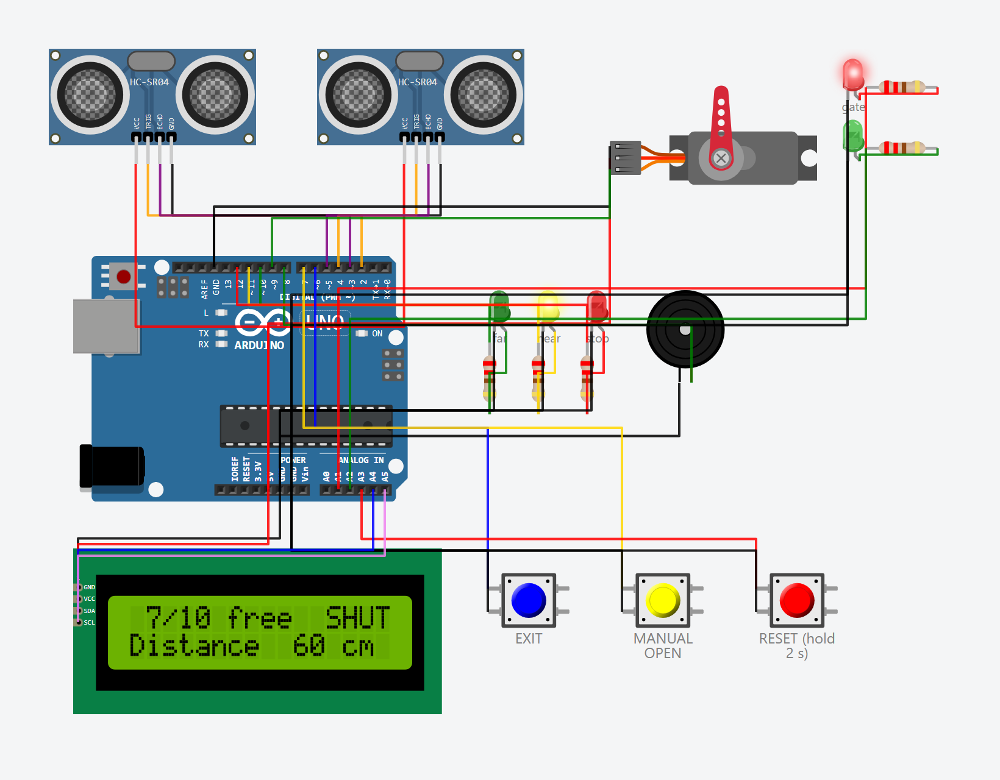

# 🚗 Smart Parking Gate

> An **Arduino Uno** parking barrier with a **parking-assist sensor**. The buzzer beeps faster as the car gets closer, and the barrier opens only when a space is free. A safety sensor stops it from ever closing on a car. Free spaces are counted, shown on an LCD and kept in EEPROM across power cuts. The project runs in the **Wokwi** simulator, so no hardware is needed.

### ▶ [Run it in the Wokwi simulator](https://wokwi.com/projects/481308607319625729)


<p align="center"></p>

Example serial log from the simulator:

```
[27598 ms] entry request
[29229 ms] gate open
[39234 ms] nobody drove through, closing
[180210 ms] car entered, occupied 1
[188412 ms] exit request
[192220 ms] car left, occupied 0
```

## How it works

| Step | What happens |
|---|---|
| 🚘 Car approaches | Sensor 1 measures the distance. Under 1.5 m the buzzer starts beeping, faster as the car gets closer, and becomes a continuous tone under 20 cm. LED bar: green > 1 m, yellow 0.5–1 m, red < 0.5 m (flashing < 20 cm). |
| ⏱ Car waits at the gate | Closer than 40 cm for 1 s means an entry request. If there is a free space, the barrier rises smoothly and the gate light turns green. If the car park is full, the barrier stays down and the LCD shows `FULL - sorry!`. |
| ⬆ Car drives through | Sensor 2 watches the space under the barrier. The car is counted only after it has been under the barrier **and** the space has been clear for 0.8 s. |
| ⬇ Barrier closes | If anything appears under the barrier while it is closing, it **goes back up** (safety reversal, like a real barrier). If nobody drives through within 10 s, the barrier closes without counting. |
| 🚪 Car leaves | The blue EXIT button (exit loop / ticket machine) opens the gate and the count goes down once the car has passed. |
| 🔧 Attendant | MANUAL opens the gate without counting. Holding RESET for 2 s empties the counter. |

The LCD shows `free spaces / capacity` and the gate state (`SHUT`, `UP`, `OPEN`, `DOWN`) on the first line. The second line shows a message, the distance to the car, or a sensor fault. Every event is logged on the serial monitor at 115200 baud.

## Circuit

| Part | Arduino pin |
|---|---|
| HC-SR04 #1, approach (TRIG / ECHO) | D2 / D3 |
| HC-SR04 #2, under the barrier (TRIG / ECHO) | D4 / D5 |
| EXIT button / MANUAL button / RESET button (to GND) | D6 / D7 / A3 |
| Buzzer | D8 |
| Servo (barrier) | D9 |
| LED bar green / yellow / red (220 Ω) | D10 / D11 / D12 |
| Gate light red / green (220 Ω) | A1 / A2 |
| LCD 16×2 I2C (address 0x27) | SDA A4, SCL A5 |

The complete wiring is in [`diagram.json`](diagram.json) (Wokwi format).

## Design choices

- **Non-blocking.** One `loop()` with `millis()` timers and no `delay()`. Only the ultrasonic pulse itself waits, for at most 25 ms. The two ultrasonic sensors are read alternately every 30 ms, so their echoes never interfere.
- **Gate state machine:** `CLOSED → OPENING → OPEN → CLOSING → CLOSED`, with the safety reversal `CLOSING → OPENING`. The reason for opening (entry, exit, manual) is stored so that each car is counted exactly once, even if the barrier has to reopen.
- **Robust sensing.** A median-of-3 filter rejects single bad echoes. Five missing echoes in a row raise a sensor fault, and a faulty under-barrier sensor is treated as "something is there" (fail-safe).
- **Buttons** are debounced in software (25 ms) and support long presses.
- **EEPROM** stores the count with a "magic" byte, so a blank chip starts at zero. It uses `EEPROM.update()` to avoid needless writes.
- **Smooth servo motion:** 1° every 12 ms, about 1.1 s for a full stroke instead of a jump.

## Run it in Wokwi

The quickest way is the [saved Wokwi project](https://wokwi.com/projects/481308607319625729): press ▶ and play. To build it yourself from this repository:

1. Open [wokwi.com/projects/new/arduino-uno](https://wokwi.com/projects/new/arduino-uno).
2. Replace the contents of `sketch.ino` and `diagram.json` with the files from this repository.
3. In **Library Manager**, add **LiquidCrystal I2C** (or add a `libraries.txt` file with the same content as the one here).
4. Press ▶. Click a distance sensor and drag its slider to move the "car"; click the buttons to exit, open manually or reset.

**Try this:**
1. Set sensor 1 to 120 cm, then 60 cm, then 15 cm, and listen to the beeping change.
2. Hold it at 30 cm: after 1 s the barrier opens.
3. Set sensor 2 to 20 cm (car under the barrier), then back to 400 cm. The barrier closes and the count goes up.
4. While it is closing, set sensor 2 to 20 cm again: it reopens.

It also runs in **Wokwi for VS Code**: compile with Arduino CLI or PlatformIO, then use `wokwi.toml`.

## Files

```
sketch.ino      firmware
diagram.json    Wokwi circuit
libraries.txt   libraries for Wokwi (LiquidCrystal I2C)
wokwi.toml      Wokwi for VS Code configuration
tools/render-circuit.html   draws diagram.json with the Wokwi part graphics (README picture)
```

## License

[MIT](LICENSE) © 2026 Goga Alex-Andrei
